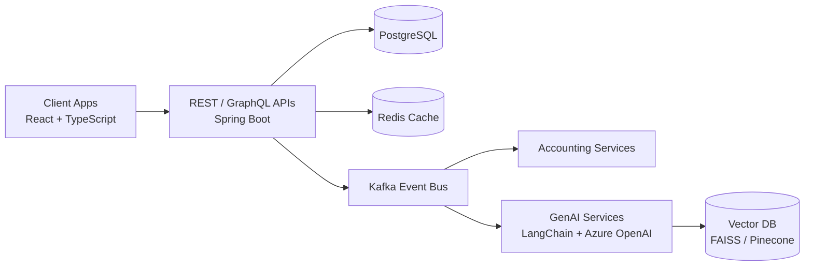

# Fiserv: Distributed Financial Services & GenAI Platform (Case Study)

> **Role:** Software Engineer · **Period:** Jan 2025 – Present · **Location:** USA
> **Note:** This is a high-level, sanitized case study. It contains no proprietary code, data, or internal details.

## Overview

I architected and own distributed financial services that power high-scale accounting workflows for millions of small and medium business (SMB) users, and I build GenAI features on top of the same transaction data.

## Impact at a Glance

| Area | Result |
| --- | --- |
| Throughput | **90K+ events/min** processed across accounting workflows |
| Support load | **35% fewer support queries** within 2 quarters (LLM-powered assistance) |
| Manual effort | **40% less bookkeeping time** via agentic categorization and reconciliation |
| API latency | **420ms → 240ms** (PostgreSQL tuning + Redis caching) |
| Partner integration | **30% more efficient** across 10+ internal services (REST + GraphQL) |
| Deployments | **45% fewer deployment failures** (Docker, EKS, Terraform) |
| Releases | Bi-weekly → **weekly** (GitHub Actions + Jenkins) |
| Reliability | **30% fewer production incidents** (CloudWatch + Datadog APM) |
| Adoption | **20%+ increase** in feature adoption (React real-time dashboards) |

## High-Level Architecture (simplified)

## What I Built

### 1. Event-driven microservices
- Designed microservices with Kafka and event-driven patterns for fault tolerance and horizontal scalability across critical financial domains.
- Owned services end to end on Java 17, Spring Boot, and AWS.

### 2. LLM-powered financial assistance
- Built features with Azure OpenAI and LangChain that generate contextual insights from transaction data.

### 3. RAG pipelines
- Built retrieval pipelines on vector databases (FAISS / Pinecone) for retrieval and summarization of invoices, receipts, and tax records.

### 4. Agentic workflows
- Implemented agent-based workflows for automated expense categorization and reconciliation.

### 5. APIs and frontend
- Exposed REST and GraphQL APIs to unify financial data access across services.
- Led frontend work in React, TypeScript, and Redux for real-time financial dashboards.

### 6. Performance, delivery, and observability
- PostgreSQL tuning and Redis caching for high-frequency queries.
- Docker, Kubernetes (EKS), and Terraform for reproducible infrastructure.
- CI/CD with GitHub Actions and Jenkins; monitoring with CloudWatch and Datadog.

### 7. Engineering leadership
- Led design reviews, mentored engineers, and drove adoption of GenAI best practices: prompt engineering, evaluation frameworks, and RAG architecture.

## Tech Stack

**Backend:** Java 17, Spring Boot, REST, GraphQL
**Frontend:** React, TypeScript, Redux
**Messaging:** Apache Kafka
**Data:** PostgreSQL, Redis, FAISS, Pinecone
**GenAI:** Azure OpenAI, LangChain, RAG, agentic workflows
**Cloud / DevOps:** AWS (EKS, EC2, S3, Lambda, IAM, CloudWatch), Docker, Kubernetes, Terraform, GitHub Actions, Jenkins
**Observability:** CloudWatch, Datadog (APM)

---
